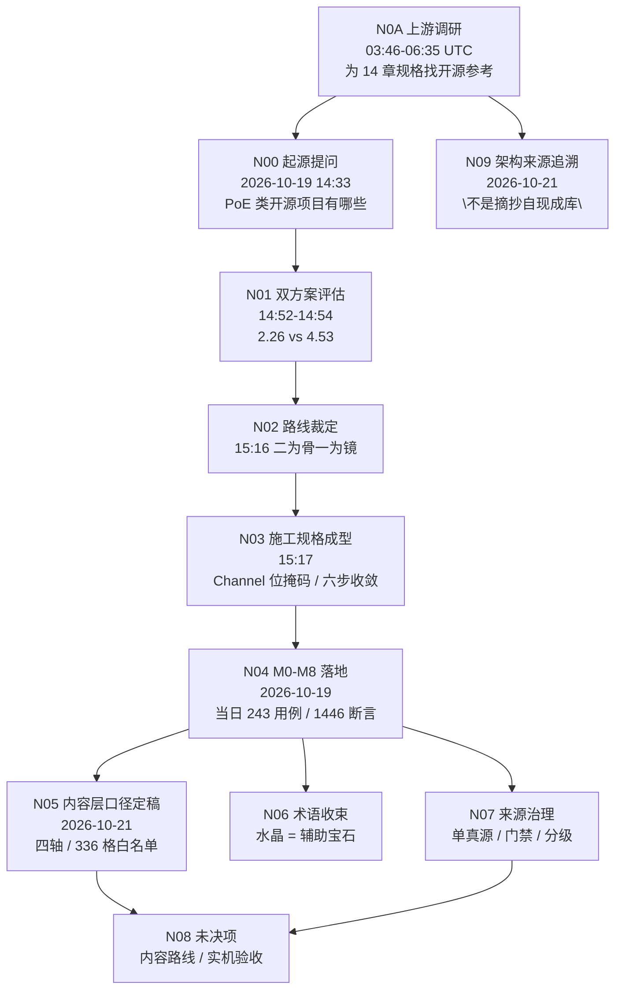

# 项目记忆图谱与证据链 v1

> **一句话**：本文件回答"这条规则从哪来、我能不能改、改了要谁同意"。
> 它是**索引**，不是新真源——与它指向的节点冲突时，**以节点为准**（台账 D-* / 施工规格 / 代码与测试）。

> **给执行 AI 的用法**：动手前先看 §六 的"修改准入五问"。答不出第 1 问，就停下申请，不要靠印象补。
> 本项目历史上最贵的两次错误，都不是写错代码，而是**在没有证据的地方自行发明规则**（D-16 记录）。

---

## 一、证据强度分级（比"文档级别"更本质）

| 级别 | 类型 | 例 | 能不能作为修改依据 |
|---|---|---|---|
| **E0** | 可运行事实 | 代码行、`@export` 字段、GUT 断言通过 | ✅ 最高，直接算 |
| **E1** | 版本历史 | `git log` / 提交 SHA / 某次 diff | ✅ 可查"什么时候、因为什么变的" |
| **E2** | 已裁定文本 | 台账 D-*、施工规格、`00/01/02` 总纲三件套 | ✅ 算，但要看它是否已被后续 D-* 替代 |
| **E3** | 会话原文 | `docs/_重要资料记录/人工资料源/000_架构起源_追本述源/证据_*.md` 里的逐字摘录 | ✅ 算"当时的原话"，不算"现在的规则" |
| **E4** | 记忆 / 印象 | AI 记忆文件、模型训练知识、他人转述 | ❌ **不得作为依据**，只能用来"提出疑问" |
| **EX** | 未投放的外部文件 | 项目外路径的一切 | ❌ 视为不存在（来源清单 R1） |

判断口诀：**能跑 > 有记录 > 有裁定 > 有原话 > 只是印象**。
低级别不能推翻高级别；高级别缺失时才允许用低级别**提出问题**，不允许直接改。

---

## 二、图谱总览



节点表：

| 节点 | 时间 | 类型 | 证据（可点） | 它确立了什麼 | 不可被"简化"的部分 |
|---|---|---|---|---|---|
| **N09** | 2026-10-21（追溯性节点） | **架构来源自证** | `res://mods/jes-skills/docs/_人工文档流程/000_架构起源_追本述源/流放之路风格高自由度技能系统文案-000.json`（E-11，45 条 / 67,950 字符）末条；**归类解读见** `res://mods/jes-skills/docs/_重要资料记录/AI资料源/架构溯源/架构起源_信息归类_v1.md`（S6，R21） | 人类直接问「这套架构的来源，或是参考了哪些资源或库」；最终结论：**「它不是摘抄自某个现成库」**。思想谱系＝PoE 语义 + PoB（事实标准答案库）+《Game Programming Patterns》四模式（Type Object / Component / Event Queue / Object Pool）+ UE GAS + 暗黑系复刻（OpenDiablo2 / devilutionX / GemRB）；**纯原创**＝W1–W5 宝石清单与数值、`systems/skills` 目录结构（上游按项目根记，本仓库因是 mod 落在 mods-jes-skills 之下，真实路径见 S0 行）、GDScript 类签名、M1–M8 排序。同一会话还记录了人类**最初的问题**：「流放之路中的技能系统，类似的开源项目有哪些？」——这是整条链真正的起点 | **不是施工依据**。它的作用是**反驳**"本项目是某开源项目的移植"这一误读，尤其反驳"PoB 语义 + arpg-kit 落地"的措辞失真（见 V-07）。**不得据"谱系里有 X"就把 X 引入依赖树**。另：该会话自述「47 个宝石」与 E-10 §12 实测 85 项矛盾（R21 已记为 AI 自述失真），**不得采信自述数字** |
| **N0A** | 2026-10-19 03:46–06:35 UTC | **上游调研** | `res://mods/jes-skills/docs/_重要资料记录/人工资料源/000_架构起源_追本述源/证据_上游起源会话_2026-10-19.md`；原始导出 `res://mods/jes-skills/docs/_人工文档流程/000_架构起源_追本述源/流放之路风格高自由度技能系统文案-000.json`（E-09） | ① 存在上游规格《高自由度技能系统规格》14 章（W1–W4＝32 主动+24 辅助+12 触发），其核心原则（管线公式 / 7 行为 / 7 触发 / 零代码新增）与本仓库**同源** ② 调研结论：**无四件套齐全的开源项目** ③ `the-exile-engine-v2` 在本调研中 **0 次出现** ④ kit 原始定位仅"测试组织可借鉴"，首选实为 `godot-gas` | **不是本仓库的施工依据**（早于 N00）。只用来说明"架构从哪来"，不得据此推翻任何 D-* |
| **N00** | 2026-10-19 14:33 | 人类提问 | `res://mods/jes-skills/docs/_重要资料记录/人工资料源/000_架构起源_追本述源/证据_起源会话_2026-10-19.md` §二 #0 | 问题起点：PoE 类技能系统的可复用开源方案 | — |
| **N01** | 2026-10-19 14:52–14:54 | 评估 | 同上 §3.1–3.2；产物已入库：`res://mods/jes-skills/docs/_重要资料记录/人工资料源/000_架构起源_追本述源/design_评估书_技能系统开源方案_v1.0.md`（E-07）+ `design_评审一页纸_方案对比.html`（E-08）；**取证已于 2026-10-21 复验成立**，见 `res://mods/jes-skills/docs/_重要资料记录/AI资料源/架构溯源/技术框架核验_PoB与arpg-kit_v1.md` | 8 维五路评审：方案一 **2.26** / 方案二 **4.53**；否决方案一的四条客观证据 | 评分数字、四条证据的具体事实 |
| **N02** | 2026-10-19 15:16 | **人类裁定** | 同上 §二 #8 | 采用方案二："二为骨、一为镜"（PoB 语义 / kit 实现 / 方案一只读参考） | **路线本身不可改**，改需人类新裁定 |
| **N03** | 2026-10-19 15:17 | 规格成型 | 同上 §3.4–3.5；`res://mods/jes-skills/docs/_AI开发与文档/02_改代码/施工规格_Godot技能系统_AI执行版_v1.0.md` §3.1 / §3.3 | ① `Channel{HIT,DOT,AILMENT}` 位掩码 + `tags` 正交 ② 六步装配 + 多轮收敛 + `conflicts_with` 回滚 ③ 黄金用例 G1–G10 | 这两条是**修 bug 后的形态**，不得退回"分系"或"线性跑一遍" |
| **N04** | 2026-10-19 | 框架落地 | `git log 12980af → fab87cc`；`res://mods/jes-skills/tests` | M0–M8 全部实现；**当日基线 243 用例 / 1446 断言**（现 **261 / 1749**，R22 实测）；D-01～D-13、P-01～P-23 均在此阶段产出 | 测试断言即事实（E0） |
| **N05** | 2026-10-21 | 内容口径定稿 | `git log 060f27e / e700056`；`res://mods/jes-skills/docs/_AI开发与文档/01_写内容/00_总纲_主动技能体系_v1.md` | 四轴（投送 6 × 形状 7 × 时序 4 × 辅助类别 2 = 336 格）、标签三类、白名单 ✅24 / ●106 / △56 / ×150 | 白名单**唯一展开处**是 `02`，别处不得再列 |
| **N10** | 2026-10-21 | **docs 结构重排**（人类裁定） | 台账 **D-21**；`res://mods/jes-skills/docs/_重要资料记录/AI资料源/架构溯源/docs目录结构说明_v1.md` | `docs/` 三个顶层文件夹：`_AI开发与文档/`（AI 地盘）/ `_人工文档流程/`（人机决策档案）/ `_重要资料记录/`（`AI资料源` + `人工资料源`）。**归属（谁的地盘）与级别（S0–S6）正交**，先问归属再问级别 | **三分区的语义不可混用**：人工区不是"低级别区"，资料库不是"回收站" |
| **N11** | 2026-10-21 | **AI 双文件夹冷热分区**（R22） | 台账 **D-22**；入口 `res://mods/jes-skills/docs/_AI开发与文档/00_开工必读.md`；库索引 `res://mods/jes-skills/docs/_重要资料记录/AI资料源/00_资料库索引.md` | 001 `_AI开发与文档/` = **热区**（做事要守的规矩，小而准）；002 `_重要资料记录/AI资料源/` = **冷区**（查证要翻的材料，大而全）。三件事：①《开工提示词》重写为 `00_开工必读.md`＝**docs 唯一入口**（按任务导航，非来源罗列）；② 4 份 S6 追溯型文档迁去冷区；③ `内容设计手册`（S1）从人工区迁入热区，**级别未变**。施工规格开头新增「§导航」（1040 行按任务查） | **入口的数字必须实测校准**：R22 发现旧入口仍写「M0 交付物」「261/1746」，而实际 M0–M8 已完成、261/1749——**入口过期比没入口更危险**，新 AI 会拿着错误基线核对。**冷区文件不是"被降级"，只是"不必开工读"**；其结论已在入口提炼 |
| **N06** | 2026-10-20 | 人类裁定 | 台账 **D-14** | 水晶 = 辅助宝石；行为名称（原"粒子"）、辅助类别（原"流派归属"） | 术语废止不可逆 |
| **N07** | 2026-10-20～21 | 治理 | 台账 **D-16 / D-18 / D-19 / D-20**；`res://mods/jes-skills/tests/docs/test_docs_provenance.gd` | 单真源、只读 `docs/`、禁项目外路径、递归门禁、S4 两类性质、证据链与引用存在性门禁 | 门禁只许加严，不许放宽 |
| **N13** | 2026-10-21 | **热区按任务组织 + 垃圾桶机制**（R23 / D-24） | 台账 **D-24**；`res://mods/jes-skills/docs/_AI开发与文档/01_写内容/`、`…/02_改代码/`、`…/03_查规则/`、`res://mods/jes-skills/docs/垃圾桶/README.md` | 人类两条指令：① **文件夹名 = 任务名**（写内容 / 改代码 / 查规则），`00_开工必读.md` 留根当唯一入口；② 无用/过时文件**移到 `docs/垃圾桶/` 而不是删**，且**任务目标、任务完成、过程稿、冻结证据一律不算过时**。配套把台账的「为什么」拆去冷区，热区只留现行规则 | **「精简」不等于「变小」**：热区体积从 264KB 降到 240KB（−24KB），但同时新增治理记录约 18KB——**新增规则本身就有重量**。真正的收益是「热区只剩 9 份、每份都在门禁 `REQUIRED_DOCS` 里」，新 AI 不会有第二选择 |
| **N12** | 2026-10-21 | **修门禁自身的静默失效**（R22 / D-23） | 台账 **D-23**；`res://mods/jes-skills/tests/docs/test_docs_provenance.gd` 第 106 行 | `test_docs_provenance.gd` 曾因两条语句被 tab 挤在同一行而 **Parse Error**，GUT 只报 "Warnings 1" 就跳过——**4 个文档门禁用例从未真正执行过**（同期的 257/1734、261/1746、257/1729 三个基线数字就是这么来的）。修复后**首次生效**，立刻暴露 30 份 md 未按 `docs/<相对路径>` 登记；补登记后基线变为 **261 用例 / 1749 断言** | **门禁"全绿"不等于"在跑"**。以后改门禁脚本后，必须确认用例数发生变化，否则就是又失效了 |
| **N08** | 进行中 | 未决 | 施工规格 §16「暂缓执行」；`res://mods/jes-skills/docs/_AI开发与文档/00_开工必读.md` 当前阶段块 | 内容生产路线 A/B/C 未裁定；Android / macOS / Linux 未实机 | **未决就是未决**，AI 不得自行选路 |

---

## 三、决策挂载点（D-01 ~ D-24）

> 每条都能落到一个节点上。找不到节点的决策 = 不该存在的决策。
> 新增 D-\* 必须同时在此追加一行，否则 `test_memory_graph.gd` 直接红（D-20 落地当天就被它抓过一次）。

| D | 一句话 | 节点 | 类型 |
|---|---|---|---|
| D-01 | 兼容性走 PoE2 前置拦截 + G7 fail-fast 兜底 | N03/N04 | 设计 |
| D-02 | 孔位上限 6，单一真源 `SOCKET_COUNT` | N04 | 实现 |
| D-03 | 投射物不按发建 Node，命中复用 1 个 Hitbox | N04 | 性能 |
| D-04 | 渲染数学抽纯函数 `instance_state()` | N04 | 可测性 |
| D-05 | 内容真源 = `content/gems/**/*.tres`，唯一入口 `GemRegistry` | N04 | 架构 |
| D-06 | RNG 契约 `next_float(stream)`，暴击只吃 `STREAM_DAMAGE` | N04 | 确定性 |
| D-07 | 装配缓存命中返回深拷贝 | N04 | 正确性 |
| D-08 | 冷却挂槽，不挂装配结果 | N04 | 心智模型 |
| D-09 | 条件门 fail-closed | N04 | 安全默认 |
| D-10 | `max_count` = 同时存在上限，满则顶最旧 | N04 | 语义 |
| D-11 | 演示 id 只许集中在一张编排表 | N04 | 纪律 |
| D-12 | `W1` = 第 1 批内容集，据此补第 8 个主动 | N04（**源头无定义**，见 §五） | 推断 |
| D-13 | Web(WASM) 非必需，保留两条纪律 | N04 | 范围 |
| D-14 | 水晶 = 辅助宝石；不得替换 `SkillData` 引用 | N06 | 术语 |
| D-15 | 条件门（第 4 口子）暂缓实现，开启清单固定 4 步 | N04/N08 | 范围 |
| D-16 | 来源治理：只读 `docs/`、禁外部路径、裁决顺序 | N07 | 治理 |
| D-17 | 等级曲线两段参数，不引入 `Curve` | N04 | 数据契约 |
| D-18 | 文档门禁递归 + 目录分级 | N07 | 治理 |
| D-19 | `99` = 给人看的合并本；`原始设计案` = 聊天历史过程稿 | N07 | 治理 |
| D-20 | 建立证据链：S6 图谱 + 冻结证据 + 引用存在性门禁 | N07 | 治理 |
| D-21 | docs 三分区：**归属（谁的地盘）先于级别（S0–S6）**，两者正交 | N10 | 治理 |
| D-22 | AI 双文件夹冷热分区：开工提示词→`00_开工必读.md` 唯一入口；4 份 S6 追溯型迁 AI 库；`内容设计手册` 归位 AI 区 | N11 | 治理 |
| D-23 | 修文档门禁自身的 Parse Error（4 用例从未执行）+ 台账按分区重组 + 基线统一为 261/1749 | N12 | 治理 |
| D-24 | 热区按任务分文件夹（`01_写内容/02_改代码/03_查规则`）+ 台账理由沿革迁冷区 + 建 `docs/垃圾桶/`（移而不删，任务目标/完成类豁免） | **N13** | 治理 |
| D-25 | §4 参数挂轴表逐键实测定稿（修正 `dash_speed`→`speed` 等键名偏差、标注 ◇ 规划键、`projectile_count`↔`count_base` 别名须知）+ `trap` 标签预留注册 | **N03/N05**（E0 代码核对，非新设计） | 数据契约 |
| D-31 | 环形判定落地：`bhv_aoe_burst.inner_radius` + `hits_ring()` 纯函数（默认 0 = 实心圆零回归）+ 首格内容 `ring_of_cinders` + 槽数 8→9 | **N04/N05** | 实现 |
| D-32 | 沙盒全行为表现层补齐：新建 `sandbox_fx_layer.gd`（近战弧光 / 引导光束 / 冲刺残影 / buff 光环，纯表现零判定改动） | **N04/N05** | 实现 |
| D-33 | 投射物渲染修复（3D 材质挂 2D 层整层隐形 → Node2D `_draw` 重写，`instance_state()` 纯函数保留）+ 输入简化（去槽位键，Q 统一施放，自动施法默认开） | **N04/N05** | 实现 |
| D-34 | 投射物连锁/分裂运行时接线：`ProjectileField` 新增 chain/fork SoA + 命中偏转/±35° 分裂 + 分裂弹防回打记忆，pf19~pf22 | **N04/N05** | 实现 |
| D-35 | 内容图纸定稿：66 格口径（65 有效 + `FLY·RING·ZONE` 特批转 ✅，其余 27 △ 格冻结不开发）+《基石全枚举_展开表_v2》（S6，每格参数集=三轴键并集）；✅13/△27 总账同步 | **N03/N05** | 口径裁定（制作人 E0）+ 文档 |
| D-36 | 弹道=参数键不加轴（制作人裁定「环绕/贝尔曲线只是投射物的表现显示」）：`motion`/`orbit_radius` 进 FLY 参数键；ω=speed÷radius（speed 唯一速度真源）；override 新增 `set` 算子；`FLY·PT·ZONE` 同格双形态（引燃弹道/环绕弹幕） | **N03/N05** | 口径裁定（制作人 E0）+ 代码 + 测试 |
| D-37 | 落烬环/环绕飞刃占位数值定值（headless 实测驱动）：环绕飞刃 55→30 伤 + CD=4.0 封死叠层（实测 220/s 超模确凿）；落烬环实测精确成立数值不动；headless 实测方法论=摆桩测承伤，不拍脑袋 | **N05** | 实现 + 数值治理 |
| D-38 | 总纲 §9 八项拍板全冻结（独立技能/走实验台/暂不做 DoT/池抽取三选一+可跳过/章节加权+锁定/首发规模 8 技能/倍率挂起/P1 复核后定）+ 环绕两问确认（多发等份分布=既有实现；任意投射物基石×环绕转化辅助=既有通路）；第 2 批 12 技能 .tres 据此落盘（20 主动 + 批次测试 8 断言） | **N03/N05** | 口径裁定（制作人 E0）+ 内容 + 测试 |
| D-39 | 第 2 批 12 技能落盘执行：12 份 `.tres` 全字段显式 + 三个补定（T3 平滑曲线 / T4 强化推荐值 40/+30%/40 / 越界白名单 S3·S4 前摇 0.2 与 D4 弹速 950）+ 内容契约 10→22（P-23）+ 批次测试八断言 + 分段曲线名单制扩到 9；基线上移 292/2146 | **N05** | 内容 + 测试 |
| D-40 | 范围扩大×位移解绑（PoE 口径佐证：冲刺距离有独立词缀池，范围只管冲刺附带判定面）：冲刺不吃范围倍率；范围扩大辅助 `exclude_tags=[movement]` 拒绝三个冲刺技能；P-26 量纲规则的边界补全 | **N03/N05** | 口径佐证 + 数据 + 测试 |
| D-41 | 基石系统复核完成：P1 八格逐格核对参数集与键状态，实装顺序 = 代码成本递增 + 每格验证一项新能力（前 3 格零/近零代码）；顺序表落总纲 §3.2 待制作人拍板 | **N03/N05** | 复核 + 提案 |
| D-42 | 标签承诺契约：TagRegistry 全 form 标签声明承诺参数面；7 行为 produced_params()/consumed_stats() 声明；SupportGemData.require_any_tags 接入 SocketGraph；契约测试 T0-T3 四规则（装了标签但行为不产出承诺参数 = 数据错误） | **N03/N05** | 口径裁定（制作人 E0）+ 机制 + 数据修复 + 测试 |
| D-43 | 判定形状化（夜间批次 A）：ShapeHit 纯函数模块（封闭枚举 pt/circ/ring/sec/line/rect/multi，几何单真源）；aoe/melee/channel/dash/summon 各扩 shape 与形状专属参数键，默认值零回归；TagRegistry 承诺面同步扩键；总纲 §4 规划键 length/width/point_count/point_spacing 转 ✅ | **N03/N05** | 机制 + 契约 + 测试 |
| D-44 | P1 正选八格落盘（夜间批次 B）：8 份 .tres 全字段显式 + 数值定标（伤害型五格 DPS 极差 2.31、线形 length 新量纲定标）+ 内容契约 22→30（P-23）+ test_p1_content 九断言；召唤墙降级为持续伤害墙（阻挡碰撞待拍板）；per_cast / path_width / path_zone_duration 夜间裁量挂复核 | **N03/N05** | 内容 + 数值 + 测试 |
| D-45 | 批次 C/D 铺量（夜间第 2 棒）：主动 30→67、辅助 10→13；37 格 ●→✅（展开表/矩阵/总纲三处回写，矩阵 §0.2 陈账更正）；剩余 ● 8 格标注表达缺口待晨间拍板；新承载口径两条（引导圆 range 承载半径 / 蓄力双段表达）；辅助三颗全过 T2/T3 | **N03/N05** | 内容 + 文档 + 测试 |
| D-46 | 夜间施工收尾核验（第 3 棒）：批次 A~E 全部完成、无半成品；契约 T0-T3 与全量门禁复核 342/4604 全绿；「待晨间复核」决策集中汇总为七组清单（形状键口径 / per_cast 与 path_width 等键语义 / FLY·CHAN·DASH·SUMN 双段表达 / 召唤墙阻挡 / 剩余 ● 8 格引擎键缺口 / 新辅助数值待 playtest / 位移 DPS 豁免口径），见台账 D-46 | **N03/N05** | 核验 + 汇总 |
| D-47 | AI 开发加速方案落地（制作人拍板 + 公司端实现）：API 地图自动生成——`tools/api_map_generator.gd` 扫描行为 .gd 声明面（`get_global_name` + produced_params/consumed_stats）+ `TagRegistry` 承诺面 + 67 主动 / 13 辅助 .tres 三维签名，`tools/gen_api_map.gd` 写 `_AI开发与文档/03_查规则/API地图.md`（S6，自动生成禁手改）；门禁 `tests/docs/test_api_map.gd` 三用例（逐字节一致 / 行数等于目录 .tres 数 / 行为类全覆盖），**反向验证已做**（手工追加假行 → 2 用例红）。已登记真源清单 §4.1 文档台账。附带拍板「会话即用即删、结论先落盘」管理口径 | **N03/N05** | 工具 + 门禁 + 文档 |
| D-48 | D-47 交付：`ApiMapGenerator`（纯函数、产物无时间戳）+ `gen_api_map.gd` 入口 + `API地图.md`（S6，四节 12.7k 字符）+ 门禁三用例（逐字节一致 / 行数对齐 `.tres` 数 / 行为类全覆盖），反向验证已做（篡改即红）；坑 P-24（`get_global_name` 取代 `get_script_class_name`、`DirAccess` 用 `get_files()`、GDScript 无 `%g`）；真源清单 §4.1 登记 | **N03/N05** | 工具 + 门禁 + 文档 |
| D-49 | API 地图入流程 + 文档回写纪律（制作人裁定「资讯统一一致」）：开工必读新增 §2.1 使用规则四条 + 任务查表、§二之二 回写纪律六行对照表、§六 收工顺序；口径「代码/文档/地图/台账四者同批更新」 | **N03/N05** | 流程口径（制作人 E0）+ 文档 |
| D-50 | FLY 复合落点结算接线：`ProjectileField.snapshot()` + 沙盒锚定模式（爆发段认领投射段下标，弹消亡点即爆心）+ `test_s_fl_landing.gd` 六用例；测试从「伤害间接验证」改为「坐标级端到端断言」并做反向注入验证 | **N03/N05** | 机制 + 测试 + 沙盒 |
| D-51 | 九项复核批量裁定：召唤墙挡路缓办 / 引导圆用 range / 蓄力双段表达 / FLY 落点已实现 / 图腾环形近似 / 剩余 8 格改走合并键批次 / 总账更正 / 抓红修法 / 辅助数值维持 PLACEHOLDER | **N03/N05** | 口径裁定（制作人 E0） |
| D-52 | 仓库级目录口径定稿：`mods/` 下一层 = 一个模块（命名 `作者-功能`），取消「作者空间」概念，模块之间不嵌套，`_shared/` 设启用条件；落地文件为仓库根 `docs/目录结构与模块口径_v1.md`（S1）；开工必读 §七 新增唯一来源例外 | **N03/N05** | 口径裁定（制作人 E0）+ 文档 |
| D-53 | 判据复刻实验（B 实验）跑完：`mods/jes-inventory` 上复刻五条治理判据，30 用例 + 3 次反向注入全部变红，结论 4/5 可复刻。发现 P1 的对象会变（真源一处 + 派生量一致性，而非常量唯一）、P2 链路越短越强、P3 的真敌人是「要改测试」（判据测试必须零硬编码 id）、**P5 是复杂度过阈值后的必需品而非通用判据**。对技能系统的最高优先回馈：内容测试硬编码 `&"fireball"` 使免费接口在测试层不成立。裁定不在通用 skill 插件化、背包停在此处 | **N03/N05** | 实验 + 测试 + 文档 |
| D-54 | R-1 整改落地：内容契约层 `test_content_contract.gd`（11 用例，遍历目录零硬编码 id，自带复发哨兵 test_z1）+ 数值快照 `content_snapshot.json`（运行时导出 80 条，配对测试 2 用例）。三次反向注入全红。整改前 71/80 内容 id 被 13 个测试硬编码、10 个早期技能零契约断言。旧批次测试保留互补。394 用例全绿 | **N03/N05** | 整改 + 测试 + 门禁 |
| D-55 | 三颗辅助占位数值（引导聚焦 +1.0s / 持续延长 +30% / 召唤强化 +40伤+60命+25%攻速）按推算值**转正定稿**，不专门安排验收试玩，后续大 playtest 统一回调；辅助侧 content/ 占位清零 | **N03/N05** | 内容裁定（制作人 E0） |
| D-56 | 合并键批次落地（D-51 的「剩余 8 格改走合并键」兑现）：`bhv_dash` 扩 `hit_count`/`tick_interval`（路径多段判定，解锁 DASH·LINE·TICK / DASH·CIRC·TICK）；`bhv_summon` 的 `formation` 补 `circ`（向日葵螺旋散布）/`multi`（多点）+ 扩 `point_count`/`point_spacing`/`delay`（解锁 SUMN·CIRC·S1 / SUMN·MULTI·S1 / SUMN·MULTI·DLY）。**零新行为**，默认值全部回落到现状语义，6 格 ●→✅ | **N03/N05** | 代码 + 测试 |

---

## 四、反向追溯：改之前先定位（两个真实例子）

**例 1：想把"六步装配 + 收敛"改成"一遍线性装配"**

1. 先找承载点：`res://mods/jes-skills/systems/skills/socket_graph.gd` 的 `assemble()`。
2. 查图谱 → N03 → 打开 `docs/_重要资料记录/人工资料源/000_架构起源_追本述源/证据_起源会话_2026-10-19.md` §3.4：**源头已经踩过这个坑**（靠前的辅助会打开靠后的兼容性，线性跑一遍会错判）。
3. 结论：不是"简化"，是**回退到一个已知错误**。要改必须由人类出新裁定，并说明为什么原证据失效。
4. 改完必须同时改 `conflicts_with` 相关断言，并在台账追加 D-*。

**例 2：觉得"点燃也该吃 hit 词缀"，想让通道位掩码合并**

1. 承载点：`res://mods/jes-skills/systems/skills/skill_channel.gd`。
2. 查图谱 → N03（§3.4 的判定式）+ §3.5 的 G9：**通道隔离是手算验过的**，混了会让整体数值偏高 30%+。
3. 结论：这是数值事故，不是口味问题。**不许合并**。

---

## 五、悬空点（没有证据的地方，禁止填坑）

> 这一节存在的唯一目的：让后来者看到"这里没有答案"，而不是自己编一个。

| # | 悬空点 | 现状 | 允许的动作 |
|---|---|---|---|
| V-01 | `W1` 的定义 | 全项目无出处，D-12 只能按字面取严（= 首批 8 个主动） | 保持现状；人类若给定义，追加 D-* 取代 D-12 |
| V-02 | 内容生产路线（CFG / 自有 `.tres` / 适配层） | **仍未裁定**，§16 暂缓。2026-10-21 已把三条路的来源、优缺点、代码冲击整理成 `docs/_重要资料记录/AI资料源/架构溯源/内容生产路线_三选一分析_v1.md`（S6，**不选路**），并指出裁 A/C 需先投放 E-04 | 停；只做线路无关的缺陷修复。**整理选项 ≠ 可以选路**——仍须人类拍 Q1/Q2/Q3 |
| V-03 | 数值平衡基线 | 从未做过 | 可在沙盒跑数据，但**不得据此改数值**，先提方案 |
| V-04 | Android 真机 60fps | 本机无 SDK / 设备 | 外部阻塞，不算缺陷 |
| V-05 | macOS / Linux 实机 | 未跑过 | 同上 |
| V-06 | `godot-arpg-kit` 具体实现 | 只在 N01 被"抄/不抄"点名，代码未入库 | 不得声称"已按 kit 实现" |
| V-07 | 「PoB 语义 + kit 落地」的**指代精度** | **2026-10-21 核验**：kit 在本仓库**零痕迹**（grep 0 / `addons/` 无 / `project.godot` 无其 autoload）；PoB **代码 0 命中**；第三方运行时依赖 **0**。二者都不是依赖，只是参考 | 说"用过 PoB + kit 写框架"属**措辞失真**。准确说法见 `res://mods/jes-skills/docs/_重要资料记录/AI资料源/架构溯源/技术框架核验_PoB与arpg-kit_v1.md` §七：「以 PoB 为校对、以 kit 为形态参考的自研框架」。**不得据此改代码**（本来就是自研），只纠正表述 |
| ~~V-08~~ | ~~上游《高自由度技能系统规格》**14 章正文**~~ | ✅ **2026-10-21 R20 已解决**：人类投放正文（475 行 / 31,658 B），**唯一一份**在 `res://mods/jes-skills/docs/_重要资料记录/人工资料源/000_架构起源_追本述源/流放之路风格 · 高自由度技能系统规格（Godot 4.7.1 落地方案）.md`（E-10；R22 按归属删掉 `_人工文档流程/` 下的重复副本）。正文实测确认：上游 §3.3 是**分系伤害**、§6 装配是**线性跑一遍** —— 正是 N03 两条硬设计的原始动因 | **已关闭**。但仍**不是施工依据**：冲突处一律以现行规格为准（分系 → `Channel`；`compatible_tags/excluded_tags` → 三元组；上游 §7「`link_constraints` 首版不做」而现行已实现） |
| V-09 | 「`godot-gas` ⭐推荐 → 最终选 `arpg-kit`」的换人理由 | 调研首选 `godot-gas`（"重合度最高"），评估书基线是 `arpg-kit`。**取舍过程无任何书面记录** | 不得编造理由。若要追，需人类口述或补证据 |
| V-10 | `the-exile-engine-v2` **从哪来** | 调研全文 **0 命中**；它在 N00（14:33）由人类直接写进提问 | 记录"人类圈定"这一事实即可，**不得猜测来源渠道** |
| V-11 | 上游 W1–W4 内容表（32 主动 / 24 辅助 / 12 触发）与本仓库 17 个内容的对应关系 | 上游有完整内容表且大量使用 PoE 原名（冰矛 / 落雷 / 横扫 / 冰霜脉冲…）；本仓库只有 8 主动 + 9 辅助，且 §15 要求术语替换。**两套内容的映射与取舍没人做过** | 不得直接照抄 W1–W4 名单做内容（撞 §15 IP 规则）。做内容仍按 `00/01/02` 三件套 + 手册 |
| V-12 | 上游规格与**本仓库施工规格**的**逐章映射** | E-10 正文已到，但**没有人做过"上游 §N ↔ 现行 §M"的对照**。已知差异只有三处（分系/装配/`link_constraints`），是抽查所得，不是系统比对。R21 已定向比对 **§3.3 / §6 / §7 / §11 / §12 / §13 / §14** 七章（结论见 `res://mods/jes-skills/docs/_重要资料记录/AI资料源/架构溯源/架构起源_信息归类_v1.md` §一/§二），**§0–§2 / §4 / §5 / §8 / §9 / §10 仍未比对** | 现在**可以接着做了**。在 §0–§2 / §4 / §5 / §8 / §9 / §10 也比对完之前，**不得声称"两版一致"或"只在三处不同"**——那仍是抽查结论，不是穷举结论 |
| V-13 | **项目真正起点的原文** | E-11 [10] 里 AI 逐字承认「对话历史较早部分已被压缩，**我目前无法看到你在最初那条消息里的原文**」。导出物中最早文本是 [0]「宝石内容扩充」6 字 + 一个 3,345 字符的压缩块；真正的第一句话只能靠 [11]「流放之路中的技能系统，类似的开源项目有那些？」**事后追认** | **停止还原**。不得编造"最初需求原文"；复述时必须标为推测。这是 D-3 类失真的**结构性成因**，不是可修复项 |

---

## 六、修改准入五问（硬流程，不许跳）

改任何代码、数据、文档前，先回答：

1. **它属于哪个节点？**（N00–N08；一个都落不上 → 走第 5 步的申请）
2. **该节点的证据强度是 E0–E3 哪一级？**（E4 印象不算）
3. **改完会证伪原节点吗？** 会 → **停**，交人类裁定；不许自行判定"原证据过时"
4. **有测试能证明改对了吗？** 没有 → 先写测试（P-23：数量/语义断言必须同步改并写明依据）
5. **要不要追加 D-\*？** 要 → 在台账**表尾追加**，禁止改写既有行

配套红线：
- 不得以"看起来缺一块"为由新增口子（D-15 的教训）。
- 不得用"顺手统一"为由改术语（D-14 已定，改需新裁定）。
- 不得把未投放的外部文件当依据（R1）；需要时按《信息来源与真源清单》§七 申请。

---

## 七、维护规则（本文件自身怎么长大）

| 规则 | 说明 |
|---|---|
| 编号只增不改 | 新节点从 **N09** 起，按时间追加；已发布节点的编号、含义不得改 |
| 一节点一事件 | 不合并"顺便也做了"的事；合并会让后来者以为两件事同一个理由 |
| 引用用 `res://` 全路径 | 门禁 `test_memory_graph.gd` 会逐条检查**文件是否存在**，写错即红 |
| 引用写章节，不写行号 | 行号会漂移；章节名稳定 |
| 证据文件只读 | `docs/_重要资料记录/人工资料源/000_架构起源_追本述源/证据_*.md` 冻结；补新材料另开 `证据_*.md` 并记 D-* |
| 本文件与节点冲突 | **以节点为准**，并回来修正本文件（修正本身也要记 D-*） |

### 变更记录

> **本表的历史行已迁冷区**（2026-10-21 R23 / D-24）：见
> `docs/_重要资料记录/AI资料源/治理档案/规格与治理_变更沿革_v1.md` §三。
> 以后**新增变更仍写在这里**，攒够一批再迁走。

## 八、自检

```bash
# 1. 台账里每条 D-* 都要在本图谱出现（覆盖率）
grep -o 'D-[0-9][0-9]' mods/jes-skills/docs/_AI开发与文档/03_查规则/踩坑与决策台账.md | sort -u
grep -o 'D-[0-9][0-9]' mods/jes-skills/docs/_AI开发与文档/03_查规则/项目记忆图谱与证据链_v1.md | sort -u

# 2. 自动化门禁（含：图谱存在、D-* 全覆盖、图谱中每个资源路径必须真实存在）
godot --headless --path . -s addons/gut/gut_cmdln.gd \
  -gtest=<仓库内>/mods/jes-skills/tests/docs/test_memory_graph.gd -gexit
```

第 2 条已入库。它拦的是**编造依据**——引用一个不存在的文件，是这条链最常见的腐烂方式。

