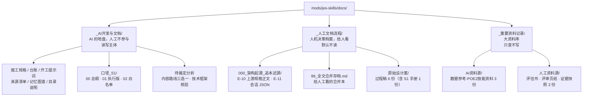

# docs 目录结构说明 v1（三分区总图 + 全量去向表）

> **级别**：S6（索引层，不产生规则）
> **状态**：2026-10-21 R20 建立，随 D-21 生效；R21 补 1 份（`架构起源_信息归类_v1.md`），总数 26 → **27**
> **它回答的问题**：docs 里 27 个文件，**谁该读、谁不该读、谁的地盘、为什么放这里**。
> 规则本身不在这里——在《信息来源与真源清单》§零。本文只解释与对照。

> ⚠️ **本文是 R20 时点的快照，不是现状。查「现在哪份文件在哪」请看《信息来源与真源清单》§四。**
> R22（2026-10-21）之后有 4 处已变，本文正文未同步（保留为迁移留痕）：
> ① `开工提示词.md` → 重写并改名 `_AI开发与文档/00_开工必读.md`（docs **唯一入口**）；
> ② `内容设计手册`（S1）由 `_人工文档流程/原始设计案/` 迁入 `_AI开发与文档/`；
> ③ 本文与 `内容生产路线_三选一分析` / `技术框架核验_PoB与arpg-kit` / `架构起源_信息归类`
>    四份 S6 由 `_AI开发与文档/` 迁入 `_重要资料记录/AI资料源/架构溯源/`（冷区）；
> ④ `_重要资料记录/AI资料源/` 新增 `00_资料库索引.md`（002 库入口）。
> **本文的价值是「三分区为什么这么分」的论证（§一）与迁移纪律（§四），不是文件清单。**

---

## 一、为什么要分三个文件夹（而不是按级别平铺）

R20 之前 docs/ 是**平铺 + 一个 reference/ 中转区**，26 份文件挤在同一层。由此产生三个具体问题：

1. **"该读什么"只能靠读完全文才知道**。施工规格、给人工看的合并本、聊天过程稿、外部资料集混在一处，
   新 AI 每接一次手都要重新判断一遍，判断错了就按过程稿生产内容。
2. **`S4` 一个级别挤了四种性质**：外部资料集 / 给人工看的合并本 / 聊天历史过程稿 / 冻结证据快照。
   级别表越写越长，但"**该不该读**"仍然没说清——四级只回答了"权威度高不高"。
3. **`reference/` 的语义发生漂移**：它原本是"项目外文档的投放中转区"（R1 的配套），
   后来评估书、评审页纸都放进去，AI 开始把它当"设计资料库"读。这与 R1「项目外文档一律不存在」开始打架。

所以引入一个**与级别正交的维度：归属**。

```
先问归属（谁的地盘）——决定"AI 读不读、写不写"
      ↓
再问级别（S0–S6）——决定"冲突时谁说了算"
```

两个维度不能互相替代。举例：`内容设计手册` 级别是 **S1**（AI 要读、可作施工依据），
但归属在 **`_人工文档流程/`**（它确实是从那批过程稿里长出来的）。如果按目录判级别，它就错了。

---

## 二、三分区总图



---

## 三、全量去向对照表（27 份）

**旧路径**一律相对 `docs/`。**级别**按《信息来源与真源清单》§二。

### 3.1 `_AI开发与文档/`（12 份）——AI 的地盘

| 新路径 | 旧路径 | 级别 | 一句话职责 |
|---|---|---|---|
| `施工规格_Godot技能系统_AI执行版_v1.0.md` | 同名（根） | **S1** | 执行约束主体：§1–§15 实现契约、§16 内容制作（暂缓）、附录 A–C。**AI 改造任何东西的回滚基线** |
| `口径_S1/00_总纲_主动技能体系_v1.md` | `设计方案_主动技能原稿/00_…` | **S1** | 内容层现行口径：四轴 6×7×4×2 = 336 格、标签三类、施放八项 |
| `口径_S1/01_AI执行版_主动技能体系_v1.md` | `设计方案_主动技能原稿/01_…` | **S1** | 轴值 → 现有 7 个 `behavior_id` 的映射；三类产物边界；三条总禁令 |
| `口径_S1/02_行为名称全集_白名单矩阵_v1.md` | `设计方案_主动技能原稿/02_…` | **S1** | 白名单**唯一展开处**（✅24 / ●106 / △56 / ×150） |
| `踩坑与决策台账.md` | 同名（根） | **S2** | D-01～D-21 决策 + P-01～P-23 坑。AI **只可追加** |
| `开工提示词.md` | 同名（根） | **S3** | 给执行 AI 的第一段话 + 当前阶段块 |
| `信息来源与真源清单.md` | 同名（根） | **S5** | 治理宪法：§零三分区 / §一五条硬规则 / §三来源登记 / §四台账 |
| `项目记忆图谱与证据链_v1.md` | 同名（根） | **S6** | 11 节点图谱 + D-\* 挂载 + E0–E4 证据强度 + 修改准入五问 + 9 个悬空点 |
| `内容生产路线_三选一分析_v1.md` | 同名（根） | **S6** | A/B/C 三路线来源与冲击。**不选路**，只供人类裁定 |
| `技术框架核验_PoB与arpg-kit_v1.md` | 同名（根） | **S6** | 四线核验：「PoB 语义 + kit 落地」是措辞失真，第三方运行时依赖 0 |
| `架构起源_信息归类_v1.md` | —（新增） | **S6** | **R21**：E-10 + E-11 按"能用来干什么"分五档 41 条（硬事实 / 废弃形态 / 可用素材 / AI 自述失真 / 无用）+ 按任务场景索引 |
| `docs目录结构说明_v1.md`（本文） | —（新增） | **S6** | 三分区为什么这么分 + 27 份去向表 |

### 3.2 `_人工文档流程/`（9 份）——人机决策档案

| 新路径 | 旧路径 | 级别 | 一句话职责 |
|---|---|---|---|
| ~~`000_架构起源_追本述源/流放之路风格 · 高自由度技能系统规格（Godot 4.7.1 落地方案）.md`~~ | 人类已自建 | ~~**S4**~~ | **R22 已删除**（与 `人工资料源/` 那份 md5 相同，人类裁定按归属保留后者）。E-10 现只剩 `人工资料源/000_架构起源_追本述源/` 一份 |
| `000_架构起源_追本述源/流放之路风格高自由度技能系统文案-000.json` | 人类已自建 | **S4** | **E-11**：45 条会话导出。末条自证「不是摘抄自现成库」 |
| `99_全文合并存档.md` | `设计方案_主动技能原稿/99_…` | **S4** | 六份过程稿按序拼接的合并本（1834 行），自带 C1–C10 冲突总表。**永不参与判定** |
| `_AI开发与文档/内容设计手册_技能与辅助宝石_v1.md` | 同名（原 `设计方案_主动技能原稿/原始设计案/`） | **S1** ⚠️ | **内容创作手册**（流程层）：18 设计模式 / 8 辅助原型 / 数值基线 / `.tres` 写法。**唯一"级别高于所在目录"的文件** |
| `原始设计案/内容规划_主动技能第2批_12个_v1.md` | 同上 | S4 | 第 2 批 12 个主动的规划（未落盘、待拍板） |
| `原始设计案/设计方案_形态类辅助宝石_v1.md` | 同上 | S4 | 「辅助宝石能否改行为」的讨论。结论已被 C3 吸收（换行为永久封禁） |
| `原始设计案/设计方案_技能基石三维模型_v1.md` | 同上 | S4 | 形状焊死在行为里的四处证据 → 三维模型 |
| `原始设计案/设计方案_技能基石池抽取三层玩法_v1.md` | 同上 | S4 | 三选一 + 可跳过、章节加权 + 锁定（待复审） |
| `原始设计案/设计方案_技能基石粒子全枚举_v1.md` | 同上 | S4 | 四轴全枚举；其 §0.5「v1.1 定稿口径」已被 00 总纲吸收 |

### 3.3 `_重要资料记录/`（7 份）——大资料库

| 新路径 | 旧路径 | 级别 | 一句话职责 |
|---|---|---|---|
| `AI资料源/数据参考-POE2技能资料/POE2_01_主要流派整合手册.md` | `数据参考-POE2技能资料/…` | S4 | 27 个流派整合。**只作模式来源，名称与数值不得进内容** |
| `AI资料源/数据参考-POE2技能资料/POE2_02_主动技能整合手册.md` | 同上 | S4 | 392 个主动技能整合（实抓自粉丝站） |
| `AI资料源/数据参考-POE2技能资料/POE2_03_辅助宝石整合手册.md` | 同上 | S4 | 133 个辅助宝石整合 |
| `人工资料源/000_架构起源_追本述源/design_评估书_技能系统开源方案_v1.0.md` | `reference/design_…` | S4 | **E-07**：八维五路评审全量取证（306 行），加权 2.26 / 4.53 |
| `人工资料源/000_架构起源_追本述源/design_评审一页纸_方案对比.html` | `reference/design_…` | S4 | **E-08**：上一份的 60 秒摘要版 |
| `人工资料源/000_架构起源_追本述源/证据_起源会话_2026-10-19.md` | 根 | **S4 冻结** | **E-06**：项目起源会话（10 条）逐字摘录。**写入即冻结** |
| `人工资料源/000_架构起源_追本述源/证据_上游起源会话_2026-10-19.md` | 根 | **S4 冻结** | **E-09**：上游调研会话（42 条 / 79,449 字符）逐字摘录 |

> **R22 补记（人类于 2026-10-21 12:31 手动重组 `人工资料源/`）**：上述 4 份已由 `人工资料源/` 根
> 移入 `人工资料源/000_架构起源_追本述源/`；同时该目录还收纳了上游规格正文（E-10）与会话 JSON（E-11），
> 并新建 `001_技能主要结构的对话过程/` 收纳 POE2 三份。
>
> ⚠️ **由此产生 4 份字节级重复副本（违反 R2），已于 R22 当日由人类裁定「按归属删」并执行完毕**：
> ① 上游规格正文 `.md` 删 `_人工文档流程/` 那份，保留 `人工资料源/000_架构起源_追本述源/`；
> ② POE2 三份删 `人工资料源/001_技能主要结构的对话过程/`（目录已不存在），保留 `AI资料源/数据参考-POE2技能资料/`。
> 理由：上游证据属「人类投放的原始件」→ 归人工资料源；POE2 属「AI 参考材料」→ 归 AI 资料源。
> **教训：副本比缺失更危险**——改了一份另一份就悄悄过期。投放资料前先查现有清单。

### 3.4 已删除（1 份）

| 旧路径 | 原因 |
|---|---|
| `reference/README.md` | 它原本是"外部文档投放规则 + 投放清单"。R20 后**目录已不存在**，留着只会变成第二个"该往哪放"的说法，与 §零 打架。职责并入《信息来源与真源清单》§零（三分区）+ §七（申请模板） |

---

## 四、AI 的读取范围（唯一需要背下来的一段）

```text
必读（施工前）
  _AI开发与文档/00_开工必读.md
  _AI开发与文档/施工规格_…_v1.0.md            §0–§2，写内容时加 §6/§7/§15
  _AI开发与文档/信息来源与真源清单.md          §零 三分区 + §五 裁决顺序
  _AI开发与文档/项目记忆图谱与证据链_v1.md      §二 节点表 + §六 修改准入五问

按需读（写内容时）
  _AI开发与文档/口径_S1/00 · 01 · 02
  _AI开发与文档/内容设计手册_…v1.md  ← 位置在人工区，但它是 S1

不读（除非追溯"为什么"）
  _人工文档流程/99_全文合并存档.md
  _人工文档流程/原始设计案/ 其余 5 份
  _重要资料记录/**                            ← 只查不写；名称与数值不得进内容

永不写
  _重要资料记录/人工资料源/000_架构起源_追本述源/证据_*.md           ← 冻结
  _人工文档流程/**                            ← 唯一例外见 D-19/D-21
```

---

## 五、迁移纪律（下次再动目录时必须遵守）

1. **先改门禁，再移动文件**。三处硬依赖必须先想清楚：
   - `tests/docs/test_docs_provenance.gd` → `REQUIRED_DOCS`（9 项，现全为带目录路径）
   - `tests/docs/test_docs_provenance.gd` → `ALLOW_EXTERNAL_PATH`（现为 `_AI开发与文档/信息来源与真源清单.md`）
   - `tests/docs/test_memory_graph.gd` → `GRAPH_PATH` / `LEDGER_PATH`（两个硬编码常量）

   > **`ALLOW_EXTERNAL_PATH` 这个坑值得记**：它原本写的是裸文件名 `信息来源与真源清单.md`，
   > 而 `_md_files()` 返回的是 `_AI开发与文档/信息来源与真源清单.md`。**迁移后豁免会静默失效**——
   > 不报错、不崩溃，只是清单里记录 E-0x 来源的那几行突然被自家门禁判成"引用项目外路径"。
   > 这类"静默失效"比直接报错危险得多。

2. **`REQUIRED_DOCS` 的语义是"缺了就会按旧口径生产"，不是"路径习惯"**。
   移动文件时必须逐项确认：这份东西还在、级别没变、AI 还找得到。

3. **冻结文件迁移只改位置，不改内容**。两份 `证据_*.md` 的 md5 迁移前后一致。

4. **改完必跑**：
   ```
   godot --headless --path . --import
   godot --headless --path . -s addons/gut/gut_cmdln.gd -gdir=res://mods/jes-skills/tests -ginclude_subdirs -gexit
   ```

5. **本文与《信息来源与真源清单》§四 必须同步**。两份都列了文件清单，
   只改一份就会变成"两个说法"——正是 D-16 要防的事。

---

## 六、未解事项（R20 留下，需人类裁定）

| # | 事项 | 现状 | 影响 |
|---|---|---|---|
| Q4 | `内容设计手册` 是否迁入 `_AI开发与文档/` | 仍是 S1 却在人工区。门禁已硬校验，**不会丢**，但语义仍别扭 | 低。AI 能按 §四 找到它 |
| Q5 | `_人工文档流程/原始设计案/` 是否改名（它现在既装过程稿又装 S1 手册） | 未改。改名会破坏人类已建立的 `000_架构起源` 叙事 | 低 |
| Q6 | 上游规格（E-10）与现行规格的**逐章映射** | 未做。目前只有抽查出的三处差异（分系 / 线性装配 / `link_constraints`） | 中。见悬空点 V-12——**在有人做完之前，不得声称"两版一致"** |

---

## 变更记录

| 日期 | 变更 | 起因 |
|---|---|---|
| 2026-10-21 / R20 | 本文建立。三分区总图 + 26 份全量去向表 + AI 读取范围 + 迁移纪律 + 3 个未解事项 | 人类指令：建立三个顶层文件夹并「查看后，整理与归纳 docs 文件夹内所有文件」 |
| 2026-10-21 / R21 | 新增 1 份 `架构起源_信息归类_v1.md`（S6，AI 区），总数 26 → 27；§3.1 计数 10 → 12（R20 时标题写 10 但实列 11，实际是 11 + 新增 1 = 12，本次一并修正） | 人类指令：分析 `000_架构起源_追本述源` 并把对 AI 有用的信息整理归类 |
